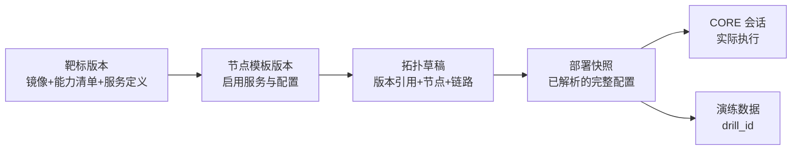

# 功能修正计划

状态：A0～A6、B1/B2 的计划内实现项已完成并部署，上次复核发现的缺项已闭环。当前环境可执行的本轮 36 项检查最终通过；EMANE 等环境外功能未验收，不计为通过。基线：`891993c`。

计划更新日期：2026-11-17。最新执行记录见 [剩余项实施与验收记录](剩余项实施与验收记录.md)。

| 批次 | 本轮代码状态 | 本轮验收状态 |
| --- | --- | --- |
| A0 | 已补齐环境准备、故障和浏览器场景脚本 | 新准备脚本真实启动独立 CORE/Bridge；测试资源清理完成 |
| A1 | 已补齐视图/会话切换释放订阅 | REMAIN-UI-003、004 通过 |
| A2 | 已补齐同名影响预览、生效状态和靶标/版本选择 | API 注册状态、同名影响及抽屉版本选择均通过 |
| A3 | 已补齐工作区与历史快照分离、变更分叉、历史转草稿 | REMAIN-012～016、UI-005 通过；原生 XML 草稿保留完整原文，升级在 xml_text 中显式修改 |
| A4 | 已补齐按件持久化、输入标识及回执校验、可编辑续办 | 硬崩溃、UI 缺件续办通过；三项按件恢复定向补验通过 |
| A5 | 已补齐身份唯一约束、待确认状态、持久化事件游标与前端去重 | 数据库不变量 5 项及 REMAIN-019～021、UI-003～004 通过 |
| A6 | 已补齐真实回滚演练 | 移除/恢复旧单元/重装当前规则全部通过，最终规则与默认策略保持一致 |
| B1 | 已补齐持久化发布草稿、冲突检查、历史引用及历史转草稿入口 | 发布、历史链路及版本选择抽屉通过 |
| B2 | 已补齐共享事务、不可变触发器、唯一约束及版本外键 | 5 项数据库不变量及真实写入通过；生产迁移、完整性和外键检查通过 |

目标：让用户能够从页面完成“导入交付物 → 创建实例 → 编排拓扑 → 启动服务 → 终端操作 → 保存恢复 → 监测复盘”，操作结果与实际运行状态一致。

改造前真实测试基线：136 个有效功能场景，100 通过、35 未通过、1 因缺少 EMANE 未执行；既有单测 144 项中 139 通过、5 项失败。35 个未通过场景包含重复根因、宿主网络配置问题和上游步骤阻断，不按 35 个独立代码缺陷排期。

完整测试记录：[真实功能报告](/tmp/core-bridge-realtest-20261116-231501/report.md)、[场景结果](/tmp/core-bridge-realtest-20261116-231501/all-functional-results.json)、[证据包](/tmp/core-bridge-realtest-20261116-231501/functional-test-evidence.tar.gz)。本文包含核心事实和验收要求，即使临时测试目录清理后也可独立用于实施。

已执行的有效真实场景 **107 项：106 通过、1 项因缺少 EMANE 阻断**；此计数仅代表已覆盖场景，不等于所有计划工作项已交付。首轮失败、夹具问题、定向补验和续测均保留原始证据。没有循环重跑整套。详见 [实施与验收记录](修正实施与验收记录.md)、[部署与回滚](部署与回滚.md)。本轮补充 36 个不同场景最终通过，首轮失败和四项获准定向补验均保留证据。本轮生产更新已完成，健康正常、0 会话；CORE daemon 未重启，独立测试资源已清理。

## 1. 范围和实施原则

- 使用问题优先：入口报错、点击受阻、保存失真、数据覆盖、恢复失败、页面卡住。
- 安全加固暂不作为本轮主线；保留已经明确裁撤的功能边界：不新增 RBAC、漏洞有效性评分、旗标注入或外源镜像自动盘点。
- 保留已实测通过的容器生命周期、真实终端、WLAN、原生 XML API、基础监测和数据保留能力，围绕失败根因及下述已纳入的设计决策调整相关路径。
- 将“已实测失败”“代码确认但尚未直接实测”“环境或用例前置条件无效”分别记录，不能用修正测试预期掩盖功能缺陷。
- 修改按下面各批集中完成。实施期间优先阅读代码、静态检查和类型检查；合并后安排一次集中验收，不为每个小改动循环跑全套。

### 1.1 已纳入的设计调整

以下八项与缺陷修正一起规划；与早期文档表述不一致时，以这里明确的目标语义为准。本次自动执行包含使用闭环、B1 完整版本管理和 B2 主数据迁移；验收结果以上表及实施记录为准。

| 决策 | 设计调整 | 本轮落点 | 后续演进 |
| --- | --- | --- | --- |
| D01 | 以“靶标版本”组织镜像、清单、服务定义；“节点实例”统一称为“节点模板”，运行中的对象称“运行节点” | A2 建立靶标登记和明确绑定；页面说明职责；旧 API/文件名保持兼容 | B1 完善靶标发布版本和历史查询 |
| D02 | 镜像能力清单与本次启用声明分离 | A2 保存可支持服务；A3 保存启用声明；A5 按启用服务做预检 | 随服务版本演进扩展能力描述 |
| D03 | 运行模式由部署时的服务声明决定；镜像版本独立管理 | A2 校验模式，A3 冻结部署声明；不再根据 tag 名猜测模式 | 不同二进制镜像通过不同靶标版本表达 |
| D04 | 拓扑草稿、部署快照、CORE 会话分离 | A3 持久保存草稿和每次部署快照，CORE 会话只是执行载体 | 后续完善部署历史比较和从历史新建草稿 |
| D05 | 模板采用版本引用，避免长期维护只能反复复制 | A3 保存明确的绑定和部署版本字段；兼容旧模板，暂时保留正在使用版本的修改保护 | B1 修改生成新版本，拓扑显式升级，已有部署保持原版本 |
| D06 | 导入是可续办的多件任务，有清晰的缺件和待生效状态 | A2 统一状态语义；A4 后台任务允许只补办失败/缺失的件 | 后续可增加任务历史检索和同包版本比较 |
| D07 | 声明一致性、服务就绪和网络联通分别展示 | A5 调整预检结果；A6 提供用户主动触发的拓扑联通检查 | 按实际支持的协议扩展检查能力 |
| D08 | 编辑范围、保存位置、生效时机和操作名称明确 | A1/A3 修正页面交互；保存草稿、部署、停止、删除、替换绑定分别表达 | B1 增加模板版本升级及差异确认 |

用户流程和主要数据关系：

平台保存草稿和部署依据，CORE 继续承担网络执行。草稿可沿用现有 CORE 兼容模型，不另行引入网络执行引擎。镜像清单是人工声明的能力范围，页面不能将其描述为平台已扫描确认的软件清单。

docker 模板绑定靶标版本；netns 模板继续声明宿主可用的系统服务，不要求绑定镜像或容器靶标版本。

数据存储方向统一为现有 SQLite：本轮新增的靶标登记、拓扑草稿、部署快照、任务和身份关系优先存入 SQLite；既有 JSON 在迁移完成前仍是其实体的明确权威来源，先补原子写入与锁。B2 再迁移清单/模板等剩余主数据，禁止同一实体长期由 JSON 和 SQLite 双向独立修改。

## 2. 分批顺序与依赖

| 批次 | 目标 | 主要范围 | 前置条件 |
| --- | --- | --- | --- |
| A0 | 建立可靠的配置和验证基础 | 存储/端口配置、独立临时文件、旧单测夹具、测试证据记录 | 无 |
| A1 | 打通页面入口与基本交互 | 导入、Docker 编辑器、节点点击、搜索、路由、事件和复制按钮 | A0 |
| A2 | 保证靶标交付物和模板声明正确 | 靶标登记、能力清单、模式语义、草稿确认、服务补录与结果反馈 | A1 |
| A3 | 保证拓扑能够真实保存和恢复 | 独立草稿、部署快照、JSON/XML、模板版本绑定及属性语义 | A2 |
| A4 | 让长操作不拖住其他功能 | 后台导入任务、进度、同步调用移出事件循环、有界缓冲 | A2；与 A3 修改的公共接口对齐 |
| A5 | 保证演练身份和监测恢复 | 会话实体身份、订阅重建、时间线、历史网络指标 | A0、A3；结合 A4 的任务生命周期 |
| A6 | 修正交换机拓扑部署条件 | 宿主 CORE 网桥转发配置、部署脚本及说明 | 独立准备，最终与应用一起验收 |
| B1 | 完善靶标和节点模板版本管理 | 发布版本不可变、修改生成新版本、拓扑显式升级、历史部署保持版本 | A2/A3 的模型与迁移基础 |
| B2 | 收敛剩余业务主数据存储 | 清单、模板等 JSON 主数据迁入 SQLite，明确单一写入来源 | A0、A2/A3 稳定，并完成迁移校验 |

先完成 A1 的入口和点击修正，再实现 A2/A3 的数据闭环。A6 属于部署工作，单独交付规则和回滚方式。各批完成表示代码工作完成，统一验收前不将其标记为“已经真实测试通过”。

本次执行范围覆盖 A0～A6 和 B1/B2。B1 通过版本实现同时运行与显式升级验收，B2 通过非空数据迁移与备份校验独立验收。下文保留各批工作项及实施阶段边界，用于核对交付。

## 3. A0：配置和测试基础

**修改范围**：`app.py`、`target_admin.py`、`platform_db.py`、`tests/conftest.py`、现有测试，以及新增的测试配置/工件辅助模块。

工作项：

1. 统一提供 CORE 地址、Bridge 端口、数据库、JSON 存储、服务目录、导入目录、审计目录和临时目录配置；默认值兼容现有部署。
2. XML 导入/导出、脚本执行改用每次请求独立的临时文件，完成后清理。解决固定 `/tmp/import_core.xml`、`/tmp/exec_script.py` 的跨用户权限和并发冲突。
3. 修正五项旧测试问题：Session.nodes 使用字典；DELETE JSON 请求使用当前客户端支持的调用方式；XML 保存夹具真实创建临时文件。
4. 所有测试的 SQLite、JSON、服务文件和临时文件使用独立路径。集成测试使用专用 daemon、端口、会话和资源前缀，退出时集中清理。
5. 将可维护的场景和小型 fixture 纳入 `tests/integration/`、`tests/e2e/`；镜像通过本机准备步骤生成，不把大镜像、浏览器二进制和依赖目录加入仓库。
6. 每个场景使用全局唯一 ID，工件保存为 `run_id/case_id/request_id`，避免 HTTP 快照被不同脚本覆盖。前置条件失败后，下游标记 BLOCKED，不算产品断言失败。
7. 明确浏览器字体、服务 OS 用户、Docker/CORE 权限、EMANE 是否可用等环境前提，避免把测试环境缺失混为页面或业务错误。

验收标准：测试不写生产数据库和固定共享临时文件；五项旧夹具问题消除；任意失败都保留原始结果、截图/trace 和清理记录。

## 4. A1：页面入口和交互

**修改范围**：`static/target-admin.html`、`static/instances.html`、`static/index.html`。

| 工作项 | 具体修改 | 验收标准 |
| --- | --- | --- |
| 导入提交 | 从 `impGrain`、`impSrc` 下拉读取值；分件区使用同一来源状态；提交前校验和异常处理覆盖整个入口 | 四种组合均进入正确流程，合法输入不再出现 null.value，错误有明确提示 |
| Docker 编辑器 | 修正详情对象作用域，处理空镜像、未编目和请求失败；切镜像/运行时取消或丢弃旧请求结果 | 新建/编辑 Docker 实例正常渲染，服务区与当前镜像一致 |
| 节点点击 | 调整节点、连线和透明命中层的层级及命中区域；节点中心和右键优先作用于节点 | 有连线时仍能正常点击、右键、拖动节点；链路空白段仍可选择 |
| 搜索 | 输入事件实际更新查询值，再过滤实例库 | 不匹配词显示空结果，清空后恢复；名称、镜像、服务检索有效 |
| Tab 路由 | 将 topo 纳入合法路由；点击导航与历史事件分别处理 | 直接打开/刷新 #topo 保持拓扑页；前进后退顺序正确 |
| 事件按钮 | 声明并维护订阅状态；切会话、离开视图、重连和关闭时正确释放 | 开启/停止事件均有真实状态，不再引用未定义 eventsActive |
| 拓扑复制 | 使用正常 DOM 事件和统一序列化函数处理复制，展示复制成功/失败 | 剪贴板得到合法对象 JSON，不再出现内联字符串语法错误 |
| 命令与终端 | 接通快捷命令按钮；清理新终端页打开后继续执行的旧弹窗代码 | 正常点击完成命令与终端操作，无未定义函数错误或多余弹窗 |

运行态属性只显示当前配置，创建/连线/删除继续冻结。定义态属性的真实保存范围在 A3 明确，避免交互修正后暴露误导性“保存成功”。

页面术语与操作同步调整：“节点模板”表示可复用配置，“运行节点”表示实际部署对象，“独立容器”明确其用途。拓扑操作直接使用“保存草稿”“部署并启动”“停止运行”“删除部署”等名称，不再用确认框的确定/取消来选择定义模式或实例化模式。容器操作按未创建、已停止、运行中分别提供创建、启动、进入终端等动作。

对应证据：UI-002～008、013、020～025；其中属性保存、快捷命令、运行态属性检查在上轮先被点击遮挡阻断，必须在最终验收中实际执行到目标动作。

## 5. A2：导入、清单和实例声明

**修改范围**：`target_admin.py`、两个管理页面；新增公共导入/模型模块，将重复入口归并到同一套实现。

本轮增加稳定的靶标 ID、交付内容版本标识和镜像/清单/服务定义的关联信息。镜像 ID 与完整 ref 分开保存，tag 作为可变引用展示。未完成的靶标记录可继续补件；完整发布版本的不可变历史及并行版本管理在 B1 实施，不能提前宣称已有完整版本隔离。

### 5.1 统一导入契约

1. 整包上传调用实际解包端点，使用后端返回的目录；前端不拼接生产绝对路径。
2. 整包和分件统一草稿结构，包含来源、目录/镜像路径、全部服务文件、模板内容、清单及件状态。
3. 草稿读取和确认使用同一版本的内容。用户修改清单、追加生成服务后，确认操作保存最终内容，不能重新读取旧文件忽略编辑。
4. 不同目录布局给出明确支持范围，目录说明与实现保持一致；多服务文件不得只读取第一份。
5. 取消草稿清理本次上传/暂存文件；用户提供的服务器原目录保留。
6. 三件继续独立记录状态。镜像必需件失败时明确显示失败并保留可修正草稿；允许缺少的服务/清单显示“待补录”。只有必需操作完成才提示“注册完成”。
7. 任务执行状态与交付物就绪状态分开：任务可已结束，但靶标仍处于“缺件”或“服务待生效”。界面给出下一步动作，不能以一个 complete 布尔值代替全部含义。

### 5.2 清单和服务定义

1. 统一校验 image/services/ports/mode 等结构、合法取值和对象绑定。错误数据返回明确的 4xx，单条历史坏记录不再拖垮整个列表。
2. 完整保留镜像 registry/组织路径/tag；清单 key、name、绑定 ref 保持一致；切换详情时重置表单/JSON 编辑状态。
3. 区分 CORE 内置服务、自定义单模式服务和模式对。内置名称不加包前缀；无 mode 条目保持无 mode；表单往返保留合法附加字段。
4. 自定义服务归属和命名处理使用结构信息，兼容合法 Python 声明格式；相关依赖名同步维护。
5. 生成新服务采用独立文件或明确的合并策略，保留已有实现。同名更新必须显示影响范围；所有导入入口执行相同的重复检查和更新规则。
6. 服务状态区分“已落盘”“待 daemon 生效”“已在 daemon 注册”。可声明服务与实际 daemon 注册信息核对，维护提示列出受影响会话；不在普通保存动作中自动重启 daemon。
7. 记录真实导入时间；同一镜像 ID 的不同 tag 能在详情和实例选择器中选择，不因列表去重而隐藏可用引用。
8. 清单保存“可支持服务”，模板/部署保存“本次启用服务”。服务条目关联其检查端口，镜像级端口保留为能力元信息；不把整个镜像的全部端口都当作每次部署必须开放的端口。

### 5.3 实例服务选择

1. docker 的全部声明服务均受镜像完整清单约束；未编目镜像在独立容器中摸底，正式实例声明演练服务前需编目。
2. mode 和 software 从权威服务信息推导并校验；不靠客户端自行填写 mode 来判互斥。
3. 同软件模式对互斥；跨软件可组合；多个单模式服务逐项展示，支持与其他条目同组存在。
4. model 默认组选中规则只在明确的用户切换时应用；编辑已有实例不覆盖原选择。
5. “全部关闭基础服务”必须与 CORE 的 model 默认回填机制一致。实现时显式处理，不把省略 services 当作空集合。当前 CORE 无法直接表达的组合应给出明确说明并阻止误保存。
6. 模式以启用服务的声明为唯一权威；image tag 不再承担独立的 normal/vuln 开关。确实使用不同二进制镜像时以不同靶标版本表达，同时检查服务与该版本的兼容关系。

验收标准：四种 UI 导入方式均完成真实落位；连续补录两组服务后两组都能声明、注册和部署；内置与单模式条目往返不失真；非法清单不污染列表；缺省/伪造 mode 无法产生冲突声明；模板的实际启动服务与选择一致；同一基座支持的不同模式由部署声明正确选择，未启用服务不被当作必须运行。

对应证据：REAL-013～015、025、027、028、080；UI-010、011；以及上轮被导入入口阻断的草稿和生成器后续流程。

## 6. A3：拓扑保存、恢复及实例绑定

**修改范围**：`app.py`、`platform_db.py`、`target_admin.py`、`static/index.html`，以及拓扑模型/序列化模块。

### 6.1 保存格式

- 平台使用独立 topology_id/revision 保存草稿，节点/链路和模板绑定属于草稿数据；不以 core_sid 作为草稿的主键。新建、编辑、保存和重新打开草稿不依赖某个 CORE 会话持续存在。
- 每次部署固化 deployment_id、草稿 revision、已解析的模板/靶标内容及完整节点/链路配置，并关联 drill_id 和当前 core_sid。运行中展示实际快照；修改草稿不会悄悄修改正在运行的部署。
- “继续运行原部署”使用原快照；同一 daemon 中同场 stop/start 保留其演练身份。“从草稿部署”或从已中断快照重新部署则创建新部署和演练身份，不与恢复原部署混用。
- daemon 重启后仍能重新打开草稿、查看原部署快照并发起新部署。原部署保留其终止/中断状态，不把新部署伪装成原部署继续运行。
- 平台 JSON 使用明确版本，保留已支持的节点类型、image、instance、model、services、图标、坐标、接口地址/ID和链路 QoS。导入导出共用模型，禁止将 Docker 一律转成 default。
- 原生 CORE XML 接到已验证可用的原生 open_xml 路径，导入后查询实际会话显示节点数；旧自定义 topology XML 明确识别，避免原生 XML 被“成功”解析成空拓扑。
- 复制、导出、查看 JSON 使用同一序列化函数；不宣称支持尚未实现的完整 CORE 配置字段。

### 6.2 实例和属性

- 后端按模板稳定 ID/版本解析权威配置；旧 instance 名作为兼容入口，在保存时解析并固定绑定。拒绝不存在的模板和请求中互相矛盾的 image/services/runtime 数据。
- 持久保存拓扑节点的实例绑定。创建、JSON/XML 导入、复制及重新部署使用同一绑定维护流程；已运行节点以实际部署快照展示。
- 分开保存用户可读节点名与实际运行资源名，运行名带部署/节点标识，避免多个部署使用相同模板名时发生 Docker 容器重名。查询、终端、审计按保存的映射定位实际资源。
- 属性页现阶段只开放已有可靠后端保存能力的坐标、图标；名称、运行时型号和服务组合通过定义态“替换实例”操作变更。该操作先验证完整定义，再保留节点位置及兼容的链路/接口重建绑定；失败应恢复原定义和引用。
- 运行态属性只读，允许的坐标移动保持可用；不再使用 localStorage 覆盖服务端名字/服务等配置。
- 客户端缓存按 drill 身份隔离；同号新会话不继承上场节点属性。刷新时以服务端实际数据为准。
- 删除节点/会话确认成功后再释放引用，失败保留原绑定。引用检查、创建/修改和删除的元数据更新需具有一致性约束。
- 统一节点位置默认值：省略 position 时使用与拓扑导入一致的默认坐标；非法值返回 4xx，避免 None.to_proto。

数据兼容：旧 JSON 仍可读取；缺少实例绑定的旧节点作为“独立配置节点”明确展示，不根据名称猜测实例。旧清单/引用先生成迁移校验结果，保留无法确认的原始记录，避免静默丢弃。

本轮的版本字段用于记录和固定已部署内容；在 B1 完成前，继续保护正在使用的版本，并保留复制/替换入口。B1 完成后，编辑模板产生新版本，已有草稿和部署仍引用原版本，用户通过“升级模板版本”明确更新草稿。

验收标准：混合拓扑 JSON 和原生 XML 导出再导入后，节点类型/镜像/服务、接口地址及 QoS 与原定义一致；保存后刷新与重新部署一致；daemon 不可用时已保存草稿仍可读取；daemon 重启后能从草稿新建部署；同号新会话不受缓存影响；失败删除不会提前解锁模板版本。

对应证据：REAL-038/069 的无坐标建节点、REAL-067/068 的格式丢失；UI-020/024/025 的保存和复制流程。正常有坐标级联删链、原生 XML API 已通过，保持其行为。

## 7. A4：后台任务和响应性

**修改范围**：导入公共服务、`target_admin.py`、`platform_db.py`、导入页面及监测/终端缓冲。

1. 新增可查询的导入任务，状态至少包括 queued/running/succeeded/partial/failed/interrupted，并持久保存每件结果及错误原因。
2. 页面确认后提交任务、查询状态；展示真实上传字节进度、加载/注册阶段和可用日志，不伪造 docker load 百分比。
3. Docker 导入使用受限后台执行器；同步 RPC、文件读写和预检等待移出事件循环。保持现有终端/SSE/其他请求的响应能力。
4. 旧同步入口复用相同的工作逻辑，避免出现两套校验与落位语义；保留兼容响应并明确新任务接口的 202/job_id 契约。
5. 任务中断后明确标记，不静默重新导入或提示完成。按件结果恢复页面，必要时提示用户续办缺件。
6. 前端日志、SSE 队列和终端审计输出在接收时限制大小，并保留被截断/丢弃的状态说明。
7. 对 JSON 配置采用原子替换和读改写同步，避免多请求或任务落位导致配置丢失。
8. 每件保存输入身份和处理结果，允许从失败件继续处理。镜像已导入且仍可用时无需用户重新上传整包；恢复前检查此前件与当前草稿是否对应，避免用旧包文件补到新版本中。

验收标准：真实慢文件导入期间健康检查与其他操作在约定测试机上保持响应（本轮场景要求小于 1.5 秒）；终端可继续输入输出；任务成功、部分失败、失败和服务重启中断均显示准确状态。长输出的存储和显示上限实际生效。

对应证据：REAL-071；REAL-013 的假成功；前序审查发现的无界日志/输出缓冲。

## 8. A5：演练身份、订阅和历史展示

**修改范围**：`bridge.py`、`platform_db.py`、会话创建/导入公共流程、`static/monitor.html`、`static/audit.html`。

### 8.1 身份

1. 在 daemon 内为 CoreEmu 进程实例和每个 Session 实体分配 UUID，平台持久保存它们与 drill_id 的映射。sid 仅作为当前寻址和展示属性。
2. 同一 Session 的 stop/start 和单独 Bridge 重启保留 drill_id；删除再创建的 Session，即使 sid 相同也签发新 drill_id；daemon 重启后属于新一代。
3. 身份不从导入的 XML/JSON 直接继承，避免复制想定复制旧演练身份。
4. CORE 9.2.1 没有现成的会话实体代次字段：需由独立适配器使用现有执行机制取得 daemon 内实体标识。该批首先静态验证适配方式及生命周期，不直接修改系统 site-packages，也不把 TCP 重连当成 daemon 重启。
5. 无法可靠取得身份时展示“归属待确认”并保留诊断，不继续按 sid 将新数据写入旧场次。
6. 对 active 身份、引用登记增加事务/唯一约束，阻止采样线程和请求线程重复签发。

### 8.2 订阅和查询

- 预检分别返回声明一致性、已启用服务就绪度、网络联通结果。未执行网络检查时显示“网络未检查”，服务本地就绪不再展示为整个环境已经可用。
- 只检查当前部署启用服务对应的进程和端口。旧清单中无法确定归属的镜像级端口显示待关联；不能因未启用的 Redis 端口未开放而判仅启用 HTTP 的部署失败。
- 网络联通由用户主动触发，按当前拓扑声明和选定源/目的节点进行最小验证；不扩展为外源镜像盘点、端口扫描或漏洞验证门禁。
- 所有创建入口统一完成身份登记与即时事件订阅，包括拓扑导入和原生 XML 导入。
- 检查 stream 的实际生命周期；结束、断线或代次变化时清理并重订阅，带受控退避。上游断开时前端能看到真实状态，不能只有心跳却假装数据正常。
- 页面先建立实时订阅，再按当前 drill 回填历史并去重；切换会话先关闭旧订阅和清空/分隔旧内容。
- 历史先在服务端按 drill 过滤，再取最近窗口并按时间正序展示；审计和缓存逐步使用同一身份。
- 统一桥吞吐字段；实时与历史共用网络计数采集，覆盖 eth10+ 等接口，区分无数据和真实零值。
- 先定位 UI-027 的初始化时序再修改，不将其扩大成“所有 SSE 都失效”。

验收标准：外部同号删除重建、daemon 重启、单独 Bridge 重启、同场 stop/start 四种情况的身份和订阅均符合上述语义；新告警能实时出现且落入正确场次；时间线不混入旧演练；实际流量能在实时和历史数据中观察到；HTTP/Redis 同镜像仅启用其中一项时，服务检查只按实际启用声明执行；服务就绪与网络不通可以被明确区分。

对应证据：REAL-078/079、UI-027；吞吐流的数值验证上轮被网络步骤阻断，须在 A6 完成后补齐。留存策略及单独 Bridge 重启恢复已通过，作为回归保护项。

## 9. A6：交换机拓扑的部署修正

**修改范围**：部署脚本、systemd 配套配置和部署说明；实施主机配置变更时单独执行并记录。

实测事实：当前主机 bridge-nf-call-iptables=1，IPv4 FORWARD 默认 drop，仅放行 p.* 直连网桥；交换机使用 b.* 网桥，跨节点 ICMP/HTTP/Redis 失败。独立直连拓扑三项均通过，服务进程本身可用。

工作项：

1. 检查当前 nft/iptables 后端，提供覆盖实际 CORE 直连和交换机网桥的定向转发配置。
2. 将配置纳入部署文件，明确 Docker/CORE 启动顺序，做到重复执行不叠加规则，并提供卸载/回滚操作。
3. 应用前保存已有规则；只变更 CORE 相关规则，保留其他容器和宿主网络行为。
4. 部署说明和页面统一展示“服务就绪”及独立的网络检查状态，明确检查范围；结合 A5 的主动联通检查展示失败的源、目的和步骤。
5. 完成交换机拓扑后验证吞吐数据和停止再部署，不能把上轮受网络阻断的场景误归为服务启动或 stop/start 缺陷。

验收标准：直连与交换机两种拓扑均完成真实 ping、HTTP 200、Redis PONG；原有 Docker 网络正常；配置重载后规则有效且可回滚。无需为此重写已通过的服务启动、WLAN和容器生命周期实现。

## 10. B1/B2：版本管理与主数据收敛

### 10.1 B1：靶标和节点模板版本

- 靶标和模板各自具有稳定 ID、版本号以及草稿/已发布状态。已发布版本的交付内容与运行声明保持不可变，修改时生成新版本。
- 拓扑固定引用具体版本；发布新版本不会自动更新既有草稿或运行部署。用户查看差异、显式升级草稿，再通过新部署应用。
- 旧版本继续为已有引用提供查询和部署依据。删除时列明草稿、快照、运行部署的引用；运行中版本不被覆盖。
- 自定义服务实现发生变化时，注册身份也要能区分版本；不同靶标版本可共享内容相同的定义，不能让一个全局同名服务被新实现静默覆盖。
- 历史部署能定位原始靶标、模板、模式、镜像身份和拓扑 revision。复制历史为新草稿时重新签发草稿/部署/演练身份。

验收标准：修改已被引用模板得到新版本；旧拓扑、旧部署不变化；新草稿显式升级后使用新内容；回看旧部署可以重现其声明配置。此能力在 B1 实施前明确标为未完成。

### 10.2 B2：剩余主数据迁入 SQLite

- 对清单、模板和剩余 JSON 数据先生成实体 ID/版本、引用完整性、重复项及坏记录的迁移校验结果。
- 按实体逐步切换权威来源，使用事务和约束维护版本/引用关系；JSON 作为导入导出或只读兼容工件，不继续作为第二个独立写入来源。
- 提供迁移前备份、完成标记和回退流程，保留无法自动判断的原始记录，不把损坏内容自动覆盖成空库。
- 使用现有 SQLite 支撑当前部署规模；根据实际并发/容量指标决定后续存储演进，不在本轮额外引入数据库服务。

验收标准：迁移前后实体与引用可核对；并发更新不会丢失数据；回退路径明确；旧格式导入导出仍可用，且每个实体只有一个权威写入来源。

## 11. 数据兼容与交付

- 修改前使用 SQLite backup 机制保存平台库，保留清单、实例和服务目录快照；不能只复制活跃 WAL 模式下的单个 .db 文件当作完整备份。
- 数据库采用有版本的增量迁移，新增任务/身份/绑定数据尽量保持旧数据可读；历史不明确的身份和缺失实现给出迁移清单。
- 旧模板作为首个历史版本或“待确认”记录导入，不因增加版本管理而重写历史部署；镜像 tag 相同但内容发生变化时保留已部署镜像身份，不能把 tag 名相同当成相同交付物。
- 已被旧补录覆盖的服务文件不能凭清单自动恢复实现；需要从原包、版本历史或备份恢复，并向用户列明缺失项。
- 文档与最终实现同步：支持的导入目录、API、拓扑版本、编辑范围、后台任务、维护窗口和网络部署条件均需明确。更新“全部完成”标记时附对应验收证据。
- 将计划、测试场景、最小 fixture、部署和回滚说明纳入仓库；大测试工件继续单独归档。

## 12. 集中验收安排

本轮 A0～A6 完成后，在专用 daemon、数据库、目录和容器前缀下执行一次集中验收。B1/B2 在各自实施后安排独立验收，不能混入本轮已完成数量。实施中不重复运行旧失败测试来试错；若集中验收失败，先分析根因并集中修正，需要追加轮次时按用户测试规则说明原因并征得同意。

| 验收组 | 必须覆盖的实际流程 | 通过条件 |
| --- | --- | --- |
| 单测与接口契约 | 修正后的既有测试、清单/模式/拓扑模型和错误结果 | 合法/非法输入符合契约；不依赖真实生产存储 |
| 页面首次使用 | 四种导入、草稿确认、服务生成/补录、Docker/netns 实例 | 正常点击完成，不通过直接调用业务函数绕过页面故障 |
| 编排与保存 | 拖拽、节点与链路选择、属性、命令、终端、搜索、路由/后退、复制 | 所有按钮有真实结果；保存后刷新和部署一致 |
| 格式往返 | 混合拓扑 JSON 和原生 XML，含镜像、服务、接口和 QoS | 往返无关键字段丢失；错误格式不能“成功导入为空” |
| 设计语义 | 靶标/模板绑定、能力与启用声明、模式权威、独立草稿和部署快照 | 关闭未启用服务不造成误报；镜像 tag 不与模式声明冲突；daemon 重启不丢草稿 |
| 实际运行 | 直连/交换机、HTTP、Redis、容器启停、模式选择后重新部署 | ping/HTTP 200/PONG 达标；对应服务真实运行 |
| 长任务 | 真实慢导入、同时终端和其他请求、任务失败/中断 | 页面不被拖住，进度和结果准确，可继续处理缺件 |
| 恢复与复盘 | 同号新会话、daemon/Bridge 分别重启、stop/start、历史/审计 | 身份不串场，订阅恢复，数据归属和顺序正确 |
| 回归保护 | 已通过的容器/PTY/WLAN/原生 XML API/保留策略 | 保持通过，测试产生资源全部清理 |

结果统一分为 PASS、FAIL、BLOCKED、SKIP；前置条件与测试工件错误单独列出，不合并成产品失败。已通过的 100 个场景作为回归基线，35 个未通过场景按根因追踪修正；修复前置问题后，补齐草稿生成器、属性目标动作、吞吐等此前未真正执行到的断言。

发布条件：当前可用环境范围内，上述关键流程没有未解决的 P0/P1；已支持功能无新增回归；测试工件和清理记录完整。缺少 EMANE、物理设备、Podman/分布式环境以及未进行的长时间压力测试明确列为验收边界，不填写为通过。

## 13. 本次计划交付状态

主要功能已修改、部署并完成记录中的场景验收，生产服务已更新。随后按计划逐项复核，确认上方仍存在未闭环细项，撤回此前“全部完成”的表述。完整清单见 [计划逐项复核与剩余工作](计划逐项复核与剩余工作.md)。

本次状态核对只阅读代码与修正文档，没有重跑测试、改动业务代码或重启服务。原始测试通过和失败证据均保持不变；测试覆盖不能替代对计划工作项的逐项交付确认。
